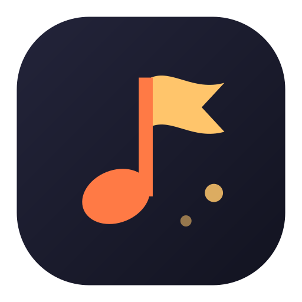

<p align="center">
  
</p>
<h1 align="center">Melody Quest 🎵</h1>

<p align="center">
  <b>A lightweight music player for gamers.</b><br>
  Level up while you listen. Your library, your soundtrack, your quest.
</p>

<p align="center">
  
  
  <a href="LICENSE.md"></a>
</p>

___

> Current version: **0.0.2** (early test build)

> **Melody Quest is a fork of [Retro Music Player](https://github.com/RetroMusicPlayer/RetroMusicPlayer)**
> (version 7.0.3) by Hemanth Savarla and the Retro Music Player contributors.
> All the core playback, library and widget work comes from them. Thank you! 💛
> Melody Quest is an independent project and is not affiliated with or endorsed by the Retro Music Player team.

## 🎮 A music player for gamers
Melody Quest turns listening into a game. Every song you play earns XP, you climb from **Rookie** to
**Legend**, take on daily quests and unlock achievements like Night Owl and Completionist. Smart Shuffle
keeps your sessions fresh, and there's a Neon style when you want the full gamer look.

And it stays out of your way while you play: nothing pops up over your game. Anything you unlocked in
the meantime is waiting for you when you come back.

## 🎯 Our goal
**Make something interesting while keeping it as lightweight as possible.**

Every feature has to earn its place, and we try to build it in the lightest way we can:
- **Local first.** No accounts, no streaming, no ads, no tracking. It plays the music on your device.
- **Light on the network.** Smart Shuffle and Quest mode run fully offline. Looking up missing song
  info is off by default, Wi-Fi only, and only fills in what's empty.
- **Light on your phone.** No heavy background jobs, no extra libraries for the new features, and
  only small font files. Game progress is a tiny file on your device.
- **You stay in control.** Quest mode, the Neon style and online lookups can each be switched off in settings.

If a new idea would make the app noticeably heavier or slower, it doesn't go in. If it can't be
lightweight, it should at least be optional.

___

## ✨ What's different from Retro Music Player

### 🎨 A look of its own
- **Melody** style (default): warm orange accent, deep ink-blue dark theme and soft paper-white light theme
- **Neon** style for the full gamer look: space-black backgrounds, electric cyan accent, magenta
  highlights, the techy Tektur display font, a glow under the play button and HUD-style outlines
- Both come in light, dark and pure black (AMOLED). Material You is still available on Android 12+
- New name, icon and splash screen; Outfit for body text; flat cards with rounder corners
- Floating mini player card with a slim progress line
- Cleaner bottom navigation and left-aligned page titles
- Redesigned home screen: big greeting, one row of quick-action tiles and a tidy suggestions grid
- Redesigned default Now Playing screen with a squircle play button and a chunky seek bar

### 🔀 Smart Shuffle
The shuffle button cycles **Off → Shuffle → Smart Shuffle**, like Spotify.
Smart Shuffle avoids playing the same artist twice in a row and mixes in songs from the rest of your
library that fit what you're listening to (shared artists, albums, composers and era, plus your most
played tracks). Suggested songs are marked with a ✦ in the queue. It all runs on your device, no internet needed.

### 🎮 Quest mode
Listening is the grind. Every song you finish earns XP, and you level up from **Rookie** to **Legend**.
- **Daily quests**: three new ones every day ("Play 5 different artists", "Finish a whole album",
  "Play 3 songs you've barely played"...). Clear all three for bonus XP.
- **Achievements**: Night Owl, Completionist, Explorer, Loyal Fan, Marathon, On a Roll and more.
- **Quest Log**: your level, stats, listening streak, quests and achievements in one place. Tap the level card on Home.
- **Gamer-friendly**: nothing pops up while you're in another app (like a game). Anything you unlocked
  meanwhile waits on the Home card.

Everything is calculated on your device. Turn it off any time in **Settings → Other → Quest mode**.

### 🌐 Fill in missing info
Turn it on in **Settings → Other → Online info**. While you're online (Wi-Fi only by default), Melody Quest
looks up the details your files are missing:
- release year, artist, album artist and composer from [MusicBrainz](https://musicbrainz.org)
- lyrics, synced when available, from [LRCLIB](https://lrclib.net)

It only fills empty fields, and **it never changes your music files**. Everything is stored inside the app
and can be cleared at any time.

Want the info in the file itself? Open the **tag editor** and tap the cloud button. It lists everything
found online (artist, album artist, composer, lyricist, genre, year, track, disc and lyrics) next to your
current values, so you can pick what to apply and then save.

## 📦 Features kept from Retro Music Player
- Light, dark and black themes, plus Material You on Android 12+
- 10+ Now Playing styles
- Browse by songs, albums, artists, genres, playlists and folders
- Gapless playback, sleep timer, driving mode
- Home screen widgets and lock screen controls
- Chromecast and Android Auto support
- Synced lyrics screen
- Tag editor
- Create, edit, import and reorder playlists and the playing queue
- Smart playlists: history, last added, most played
- 30+ languages

## 🛠️ Building
Requirements: Android Studio (recent version) or the Android SDK command-line tools, and JDK 21.

```bash
git clone <this repository>
cd MelodyQuest
./gradlew assembleNormalDebug     # or assembleFdroidDebug
```

The APK will be in `app/build/outputs/apk/`.

## 🙏 Credits
- [Retro Music Player](https://github.com/RetroMusicPlayer/RetroMusicPlayer) by Hemanth Savarla and contributors, the project Melody Quest is built on
- [MusicBrainz](https://musicbrainz.org) for song information
- [LRCLIB](https://lrclib.net) for lyrics
- [Outfit](https://fonts.google.com/specimen/Outfit) and [Tektur](https://fonts.google.com/specimen/Tektur) typefaces (SIL Open Font License, see [`licenses/`](licenses/))

A full list of what was changed from Retro Music Player is in [MELODY_QUEST.md](MELODY_QUEST.md).

## 🗂️ License
Melody Quest, like Retro Music Player, is released under the
[GNU General Public License v3.0](LICENSE.md). You're free to use, study, change and share it under
the same license.

> **Note:** Melody Quest plays music stored on your device. It doesn't stream or download music. The
> only things it fetches online are song details and lyrics, and only if you turn that on.
